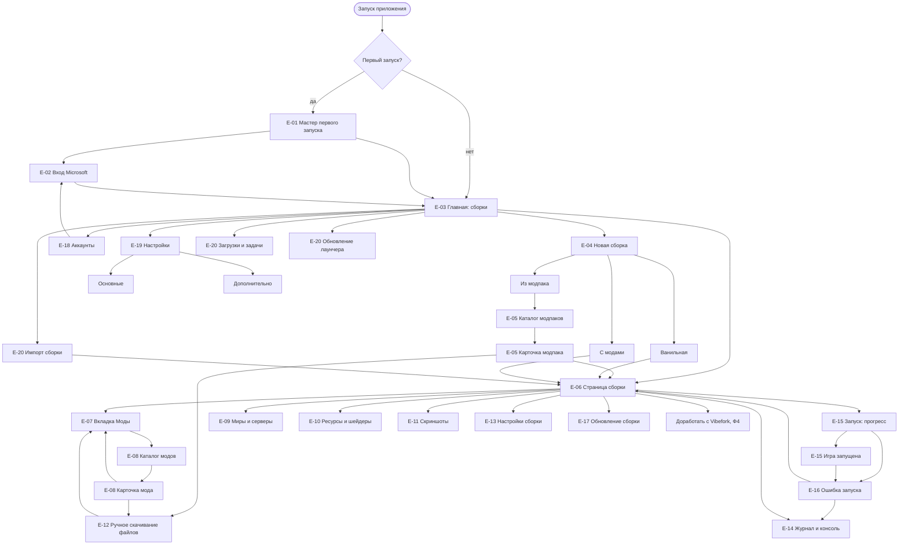

# Сценарии пользователя и карта экранов

Документ описывает, что делает игрок без технических знаний и какие экраны VibeLauncher для этого нужны. Основа для дизайн-системы, макетов экранов и интерфейса на egui.

## 1. Принципы

- **Ноль технических вопросов.** Лаунчер не спрашивает про Java, память, аргументы, версии загрузчиков, форматы модпаков. Всё это он определяет сам.
- **Прогрессивное раскрытие.** Три уровня: основной (всё, что нужно для игры), «Подробнее» (раскрывающиеся блоки на тех же экранах), «Дополнительно» (отдельные вкладки и страницы настроек). Любая возможность PrismLauncher доступна, но не на основном уровне.
- **Решение по умолчанию всегда есть.** Каждый шаг можно пройти кнопкой «Далее» / «Играть» без ввода данных.
- **Язык игрока.** «Сборка» вместо «инстанс», «Ошибка запуска: не хватает памяти» вместо кода выхода и стека. Технические детали доступны под «Подробности».
- **Ошибка = объяснение + действие.** У каждой ошибки одна главная кнопка-исправление.
- **Ограничения egui.** Интерфейс из прямоугольных панелей, списков, сеток карточек, модальных окон и тостов. Без блюра, сложных теней, CSS-анимаций, произвольной вёрстки текста. Допустимы простые переходы (появление, прогресс). Списки виртуализированы. Описания с мод-платформ показываются упрощённо (заголовки, абзацы, ссылки, списки, картинки по запросу). Каждый экран работает с клавиатуры и в масштабе интерфейса 100–200 %.

## 2. Персоны

### Аня, 14 лет, играет с друзьями на сервере
- Устанавливает игру по ссылке от друга, мало читает, не знает, что такое Java.
- Цель: зайти на сервер друзей, на нужной версии, с модами сервера.
- Ожидает: «нажал — играю». Ошибки пугают, ищет кнопку «починить».

### Максим, 35 лет, играет по вечерам, любит сборки
- Ставит модпаки с Modrinth и CurseForge, иногда добавляет пару модов от себя.
- Цель: поставить сборку, обновить её, не потеряв свои миры и добавленные моды.
- Ожидает: понятные обновления, предупреждения о несовместимых модах, возможность откатить.

### Олег, 28 лет, опытный пользователь PrismLauncher
- Несколько десятков сборок, группы, свои аргументы Java, консоль.
- Цель: перенести привычный процесс, не потеряв возможностей.
- Ожидает: импорт из Prism/MultiMC, настройки на сборку, консоль, экспорт, командная строка. Открывает «Дополнительно» сразу.

Основной дизайн ориентирован на Аню и Максима; Олег определяет, что должно быть в «Дополнительно».

## 3. Сценарии

Обозначения: **Пользователь** — действия и решения игрока; **Лаунчер** — что лаунчер делает сам; «Если не так» — отклонения.

### 3.1. Первый запуск

Цель: от открытия приложения до главного окна за 1–2 минуты.

| Шаг | Пользователь | Лаунчер |
|---|---|---|
| 1 | Открывает приложение (первый раз) | Определяет язык ОС и тему (светлая/тёмная), создаёт каталог данных, показывает мастер |
| 2 | Подтверждает язык (по умолчанию — язык ОС) | Применяет язык сразу |
| 3 | Видит приветствие: «Войти и играть» или «Играть без входа» | — |
| 4 | Выбирает «Войти» → сценарий 3.2 | — |
| 5 | Нажимает «Готово» | Скрытно проверяет сеть и свободное место; Java докачивается при первом запуске сборки |
| 6 | Попадает на главный экран с предложением «Создать первую сборку» | Предлагает последнюю релизную версию |

Решает сам лаунчер: Java, каталог данных, тема, число параллельных загрузок.
Дополнительно (не в мастере): портативный режим, свой каталог данных, прокси. Импорт из другого лаунчера предлагается ссылкой «У меня уже есть сборки в Prism/MultiMC» на главном экране, если такие найдены.

Если не так: нет сети — мастер завершается, главный экран работает в режиме «нет сети» (доступны локальные сборки); баннер с кнопкой «Повторить».

### 3.2. Вход Microsoft

| Шаг | Пользователь | Лаунчер |
|---|---|---|
| 1 | Нажимает «Войти через Microsoft» | Открывает системный браузер со страницей входа; в окне показывает «Ждём вход в браузере» и «Отмена» |
| 2 | Входит в аккаунт Microsoft в браузере | Принимает ответ, проходит цепочку Xbox Live, XSTS, Minecraft Services без участия игрока |
| 3 | Видит «Привет, <ник>!» со скином | Проверяет наличие Minecraft Java Edition, сохраняет токен в системном хранилище секретов |
| 4 | Нажимает «Продолжить» | Возвращает на предыдущий экран |

Запасной путь: ссылка «Не открывается браузер?» показывает код и адрес для входа на другом устройстве с кнопкой «Скопировать».

Решает сам лаунчер: обновление токенов при каждом запуске; повторный вход только если токен окончательно истёк.

Если не так:
- Игра не куплена: «На этом аккаунте нет Minecraft Java Edition» — кнопки «Открыть страницу покупки» и «Войти другим аккаунтом»; доступен оффлайн-режим (ник без входа) с пометкой, что онлайн-серверы недоступны.
- Детский аккаунт без разрешения родителей: объяснение и ссылка на настройки семейной группы Microsoft.
- Вход отменён или истекло время: возврат на шаг 1 без красной ошибки.
- Нет сети: «Не удалось связаться с Microsoft. Проверьте интернет» и «Повторить».

Дополнительно: несколько аккаунтов, аккаунт на сборку, оффлайн-аккаунт, скины и плащи.

### 3.3. Создание сборки

Три пути в одном окне «Новая сборка» (плитки): **Ванильная**, **С модами** (загрузчик), **Из модпака**. По умолчанию выбрана ванильная.

**Ванильная**

| Шаг | Пользователь | Лаунчер |
|---|---|---|
| 1 | «Создать сборку» → плитка «Ванильная» | Предзаполняет имя («Minecraft 1.x.y») и последнюю релизную версию |
| 2 | При желании меняет имя и версию («Последняя», «Другая…») | В «Другая» по умолчанию без снапшотов; флажок «Показать снапшоты и старые» |
| 3 | «Создать» | Создаёт сборку, показывает в списке; файлы игры скачиваются при первом запуске с прогрессом |

**С модами**

| Шаг | Пользователь | Лаунчер |
|---|---|---|
| 1 | Плитка «С модами» | Показывает выбор: Fabric, Quilt, NeoForge, Forge с одной строкой пояснения; рекомендованный выбран заранее |
| 2 | Выбирает загрузчик и версию игры | Подбирает версию загрузчика сам (последняя стабильная); показывает только существующие сочетания |
| 3 | «Создать» | Создаёт сборку и предлагает перейти к установке модов |

**Из модпака** → сценарий 3.8.

Решает сам лаунчер: версия загрузчика, версия Java, объём памяти, папки, значок.
Дополнительно: группы, значок, заметки, шаблоны, копия существующей сборки, несколько корней сборок.

Если не так: сборка с таким именем уже есть — добавляется номер; несуществующие пары «версия игры + загрузчик» не предлагаются.

### 3.4. Установка модов

Страница сборки, вкладка «Моды».

| Шаг | Пользователь | Лаунчер |
|---|---|---|
| 1 | «Добавить моды» | Открывает каталог, отфильтрованный по версии игры и загрузчику сборки (фильтры скрыты, виден бейдж «Подходит для Fabric 1.x.y») |
| 2 | Ищет по названию или смотрит популярное; открывает карточку мода | Показывает описание, скриншоты, число загрузок, источник (Modrinth / CurseForge) |
| 3 | «Установить» | Выбирает подходящую версию мода, скачивает вместе с обязательными зависимостями: «Установлено: мод + 2 необходимых» |
| 4 | Видит мод в списке «Установлено» | Название, значок, версия, переключатель «Включён» |
| 5 | Включает/отключает, удаляет мод | Предупреждает, если от него зависят другие моды |

Также: перетаскивание файла `.jar` в окно (ручной мод, пометка «Добавлен вручную»).

Решает сам лаунчер: версия мода под версию игры и загрузчик, зависимости, место файла, проверка хеша.

Если не так:
- Нет подходящей версии: «Для Fabric 1.x.y этого мода пока нет» + «Показать другие версии игры».
- Мод запрещает сторонние загрузки (CurseForge): «Автор разрешает скачивание только на сайте» — кнопка «Открыть страницу»; после скачивания лаунчер находит файл в папке загрузок и предлагает добавить его.
- Несовместимость с установленным: предупреждение до установки, «Всё равно установить» / «Отмена».

Обновление модов: «Проверить обновления» → «Можно обновить: N» с «Обновить все» и возможностью снять отдельные.
Дополнительно: смена версии мода вручную, теги и группы модов, открытие папки.

### 3.5. Запуск

| Шаг | Пользователь | Лаунчер |
|---|---|---|
| 1 | Выбирает сборку, нажимает большую кнопку «Играть» | Молча обновляет токен, проверяет Java и файлы игры |
| 2 | Видит прогресс «Подготовка… Загрузка игры 45 %» | Докачивает недостающее (игра, библиотеки, ассеты, Java), проверяет целостность |
| 3 | Ждёт | Запускает игру; кнопка становится «Играет…» со временем сессии |
| 4 | Играет | По настройке сворачивается или остаётся открытым; считает время игры |
| 5 | Закрывает игру | Показывает общее время игры; кнопка возвращается к «Играть» |

Быстрые входы: «Играть на сервере» и «Играть в мир» (со страницы сборки).

Решает сам лаунчер: версия Java, объём памяти по ОЗУ компьютера, аргументы, natives.
Дополнительно: консоль игры, переопределения Java/памяти/окна, команды до/после запуска, переменные окружения, оффлайн-запуск, принудительная остановка.

Если не так: вход недействителен — окно входа; нет сети при первом запуске — «Для первого запуска нужен интернет»; уже загруженная сборка запускается без сети.

### 3.6. Ошибка запуска и её разбор

| Шаг | Пользователь | Лаунчер |
|---|---|---|
| 1 | Видит, что игра закрылась или прогресс остановился | Определяет сбой по коду выхода, журналу и отчёту о падении |
| 2 | Видит окно «Игра закрылась с ошибкой» | Формулирует причину человеческим языком, предлагает одно главное действие |
| 3 | Нажимает главную кнопку | Выполняет исправление, предлагает «Играть снова» |
| 4 | Если не помогло — «Подробности» | Вкладки «Что случилось», «Журнал», «Отчёт о падении» |
| 5 | «Отправить журнал» | Загружает журнал в сервис выгрузки, копирует ссылку; личные данные (имя пользователя ОС, токены) вырезаются |

Каталог типовых ошибок:

| Причина | Сообщение игроку | Главное действие |
|---|---|---|
| Нехватка памяти | «Игре не хватило памяти» | «Дать больше памяти» (значение предлагает лаунчер) |
| Не та версия Java | «Для этой версии нужна другая Java» | «Исправить» (скачать нужную) |
| Повреждены файлы игры | «Файлы игры повреждены» | «Проверить и починить файлы» |
| Мод вызывает падение | «Падение связано с модом <имя>» | «Отключить мод» / «Обновить мод» |
| Версия мода не подходит игре | «Мод <имя> не подходит этой версии игры» | «Найти подходящую версию» |
| Нет зависимости мода | «Модам не хватает: <имя>» | «Установить недостающее» |
| Графика / драйвер | «Не удалось запустить графику» | Подсказка обновить драйвер |
| Недействительный вход | «Нужно войти заново» | «Войти» |
| Нет места на диске | «Недостаточно места на диске» | «Очистить кэш и старые версии» |
| Неопознанная ошибка | «Игра закрылась неожиданно» | «Отправить журнал», «Открыть папку журналов» |

Решает сам лаунчер: анализ причины, предложение исправления, очистка личных данных из журнала. Если причину определить не удалось, лаунчер так и говорит и не угадывает.
Дополнительно: полная консоль, поиск по журналу, фильтр уровней, поиск мода, который ломает игру (пошаговый мастер: половина модов выключается, игрок проверяет, повторяется).

### 3.7. Обновление лаунчера и сборки

**Лаунчер**

| Шаг | Пользователь | Лаунчер |
|---|---|---|
| 1 | Видит незаметный баннер «Доступно обновление» | Проверяет обновления в фоне при старте |
| 2 | «Обновить» или «Позже» | Скачивает, проверяет подпись манифеста и контрольную сумму |
| 3 | «Перезапустить» | Заменяет файлы и перезапускает; во время игры не обновляется |

Если не так: подпись не прошла — «Обновление отклонено, повторите позже», лаунчер продолжает работать.

**Сборка**

| Шаг | Пользователь | Лаунчер |
|---|---|---|
| 1 | На карточке сборки видит метку «Обновление игры» или «Обновления модов: N» | Проверяет в фоне раз в сутки и по кнопке |
| 2 | Открывает «Что изменится» | Список: версия игры, какие моды обновятся, какие не поддерживают новую версию |
| 3 | «Обновить» | Перед обновлением делает снимок (моды, конфиги), миры не трогает; при смене версии игры предлагает работать в копии |
| 4 | «Играть» | При проблеме предлагает «Вернуть как было» |

Для сборок из модпака: обновление сохраняет изменения игрока (добавленные моды, настройки); конфликты показываются списком с выбором «Оставить моё» / «Взять из модпака».

Решает сам лаунчер: что обновлять безопасно, снимок до обновления, откат.
Дополнительно: закрепление версии («не обновлять»), отключение проверок, ручной выбор версий.

### 3.8. Установка модпака

| Шаг | Пользователь | Лаунчер |
|---|---|---|
| 1 | «Новая сборка» → «Из модпака» | Поиск по Modrinth/CurseForge и поле «Ссылка или файл» |
| 2 | Ищет модпак, открывает карточку | Описание, версия игры, загрузчик, число модов, размер загрузки |
| 3 | «Установить» | Создаёт сборку, скачивает моды и файлы, показывает общий прогресс |
| 4 | Ждёт или продолжает пользоваться лаунчером | Загрузка идёт в фоне, в списке карточка с прогрессом |
| 5 | «Играть» | — |

Другие входы: перетаскивание `.mrpack` / `.zip` в окно, ссылка из буфера обмена, открытие файла двойным щелчком.

Если не так:
- Моды с запретом сторонних загрузок: один общий экран «Нужно скачать N файлов вручную» со ссылками и автоподхватом из папки загрузок.
- Мало места: сообщение с размером до начала загрузки.
- Часть файлов не скачалась: «Установлено с ошибками: N» и «Повторить только их».

Решает сам лаунчер: версия игры, загрузчик, Java, память.
Дополнительно: импорт из Prism/MultiMC, ATLauncher, FTB, Technic, packwiz; экспорт сборки как модпака; проверка целостности.

### 3.9. «Доработать с Vibefork» (набросок, Ф4)

Предварительный набросок; детали уточняются при реализации.

| Шаг | Пользователь | Лаунчер |
|---|---|---|
| 1 | На карточке мода или сборки нажимает «Доработать с Vibefork» | Показывает, что можно доработать: мод (если известны исходники) или сборку (конфиги, состав, настройки) |
| 2 | Описывает словами, что изменить («пусть факелы горят дольше») | Передаёт задачу агенту Vibefork, показывает ход простыми шагами |
| 3 | Смотрит план и результат | Если нужен редактор с холстом — открывает его в браузере или отдельном окне |
| 4 | «Применить» | Мод: собирает доработанную версию и подменяет файл в сборке; сборка: меняет конфиги/состав. Предварительно делает снимок |
| 5 | «Играть» и проверка | Если не понравилось — «Вернуть исходный мод/сборку» одной кнопкой |

Решает сам лаунчер: получение исходников, форк, сборка (инструменты и Java), подмена файла, откат.
Согласие: перед передачей чего-либо автору мода или платформе Vibefork — отдельный явный вопрос с описанием, что уходит; по умолчанию ничего не отправляется.
Если не так: исходников нет — «У этого мода нет открытых исходников», остаётся доработка настроек; сборка не получилась — объяснение и «Оставить как было».

## 4. Карта экранов

### 4.1. Структура и переходы

Постоянные элементы: левая панель навигации и верхняя полоса с аккаунтом и индикатором фоновых задач.

### 4.2. Что берётся из PrismLauncher, что упрощается, что прячется

| Область | Основной уровень | Упрощено | В «Дополнительно» |
|---|---|---|---|
| Сборки | Сетка/список карточек, «Играть», создать, удалить | «Инстанс» → «Сборка», один диалог с тремя плитками | Группы, ручная сортировка, шаблоны, несколько корней, копия с выбором содержимого, ярлыки |
| Компоненты | Версия игры и загрузчик в одном поле | Версия загрузчика подбирается сама | Редактор компонентов, патчи, jar-моды |
| Аккаунты | Один вход, аватар | Вход одной кнопкой | Несколько аккаунтов, аккаунт на сборку, оффлайн-аккаунт, скины |
| Java | Не показывается | Автовыбор и автоскачивание | Выбор Java, поиск установленных, память, аргументы |
| Запуск | «Играть», прогресс, понятные ошибки | Каталог ошибок с одним действием | Консоль, команды до/после, переменные, wrapper, GameMode/MangoHud, GPU |
| Моды | Каталог, установка, вкл/выкл, «обновить все» | Фильтры подставляются по сборке | Смена версии, теги и группы, ручные зависимости, поиск виновного мода |
| Модпаки | Поиск, установка, обновление | Один вход для Modrinth/CurseForge/файла | Импорт Prism/ATLauncher/FTB/Technic/packwiz, экспорт |
| Миры/серверы | Список, «Играть» | Быстрый вход на сервер | Бэкап миров, датапаки мира, пинг, редактирование списка |
| Скриншоты | Просмотр, открыть папку | — | Выгрузка, пакетное удаление |
| Обновления | Метка и «Обновить» | Снимок и откат автоматически | Закрепление версий, проверка целостности |
| Настройки | Язык, тема, поведение при запуске | Короткий список | Сеть, прокси, каталоги, параллелизм, журналы, переопределения на сборку |
| Vibefork | Кнопка «Доработать» | — | Расширенные параметры агента |

## 5. Экраны

Для каждого экрана: назначение, данные, действия, пустые и ошибочные состояния.

### E-01. Мастер первого запуска
- **Назначение:** довести до рабочего состояния без технических вопросов.
- **Данные:** язык, тема, состояние входа.
- **Действия:** выбрать язык, «Войти и играть», «Играть без входа», «Далее», «Назад».
- **Состояния:** нет сети — пропуск входа с баннером; найден другой лаунчер — ссылка на импорт.

### E-02. Вход Microsoft
- **Назначение:** войти в аккаунт.
- **Данные:** ожидание браузера; код и адрес (запасной путь); результат — ник и скин.
- **Действия:** «Открыть браузер ещё раз», «Скопировать код», «Отмена», «Продолжить».
- **Состояния:** нет Minecraft на аккаунте, детский аккаунт, истекло время, нет сети, отмена.

### E-03. Главная: сборки
- **Назначение:** точка входа; выбрать сборку и играть.
- **Данные:** карточки сборок (имя, значок, версия игры, загрузчик, время игры, последний запуск, метки обновлений), активные задачи, аккаунт.
- **Действия:** «Играть», «Создать сборку», поиск, переключатель список/сетка, меню карточки (открыть, переименовать, копировать, удалить, открыть папку), импорт.
- **Состояния:** пусто — «Создайте первую сборку» с тремя плитками; нет сети — баннер; сборка повреждена — карточка с пометкой и «Починить» / «Удалить».

### E-04. Новая сборка
- **Назначение:** создать сборку одним из трёх способов.
- **Данные:** имя, плитка способа, версия игры, загрузчик.
- **Действия:** выбрать плитку, изменить имя/версию, «Создать», «Отмена».
- **Состояния:** нет сети — версии из кэша, иначе «Нужен интернет»; дубликат имени — автоматический номер; «Из модпака» ведёт в E-05.

### E-05. Каталог модпаков и карточка модпака
- **Назначение:** найти и установить модпак.
- **Данные:** поиск; список (значок, название, автор, версия игры, загрузчик, загрузки); карточка: описание, версии, размер.
- **Действия:** поиск, фильтр по версии игры, выбор версии модпака, «Установить», вставить ссылку, открыть файл.
- **Состояния:** ничего не найдено; ошибка сети — «Повторить»; запрет сторонних загрузок — E-12.

### E-06. Страница сборки
- **Назначение:** всё о сборке в одном месте.
- **Данные:** шапка (имя, значок, версия, загрузчик, время игры), вкладки, кнопка «Играть», метки обновлений.
- **Действия:** «Играть», переходы по вкладкам, «Обновить», «Доработать с Vibefork» (Ф4), меню (переименовать, копировать, экспорт, удалить).
- **Состояния:** сборка повреждена — баннер «Починить»; идёт загрузка — прогресс вместо «Играть».

### E-07. Вкладка «Моды»
- **Назначение:** управление модами.
- **Данные:** список модов (значок, название, версия, источник, включён, пометка «Добавлен вручную»), число доступных обновлений.
- **Действия:** «Добавить моды», вкл/выкл, удалить, «Проверить обновления», «Обновить все», перетаскивание файла, поиск по списку, открыть папку.
- **Состояния:** пусто — «Модов пока нет. Добавьте первый»; ванильная сборка — «Добавить поддержку модов» (выбор загрузчика); не удалось прочитать мод — пометка у строки.

### E-08. Каталог модов и карточка мода
- **Назначение:** найти и установить мод.
- **Данные:** поиск, результаты (сетка или список), бейдж «Подходит для <загрузчик> <версия>»; карточка: описание, скриншоты, версии, зависимости.
- **Действия:** поиск, сортировка, «Установить»; в «Дополнительно» — «Показать другие версии игры».
- **Состояния:** нет результатов; нет подходящей версии; уже установлен («Установлен», «Обновить»); ошибка сети.

### E-09. Вкладка «Миры и серверы»
- **Назначение:** запуск прямо в мир или на сервер.
- **Данные:** миры (название, режим, последний запуск, размер); серверы (название, адрес, онлайн, значок).
- **Действия:** «Играть» в мир/на сервер, копия и бэкап мира, добавить сервер, открыть папку.
- **Состояния:** пусто — «Миров пока нет, они появятся после первой игры»; сервер недоступен — «Не отвечает».

### E-10. Вкладка «Ресурсы и шейдеры»
- **Назначение:** ресурс-паки, шейдеры, датапаки.
- **Данные:** списки по типам, включённость.
- **Действия:** добавить из каталога или файлом, вкл/выкл, удалить.
- **Состояния:** пусто по каждому типу; для шейдеров без нужного мода — подсказка установить его.

### E-11. Вкладка «Скриншоты»
- **Назначение:** просмотр снимков экрана.
- **Данные:** сетка миниатюр с датой.
- **Действия:** открыть, скопировать, удалить, открыть папку.
- **Состояния:** пусто — «Скриншотов нет».

### E-12. Ручное скачивание файлов
- **Назначение:** моды и модпаки с запретом сторонней загрузки.
- **Данные:** список файлов со ссылками, статус «Найден в загрузках».
- **Действия:** «Открыть страницу», «Выбрать файл», «Продолжить» (активна, когда все файлы найдены), «Пропустить» (с предупреждением).
- **Состояния:** файл не найден; контрольная сумма не совпала — «Это не тот файл».

### E-13. Вкладка «Настройки сборки»
- **Назначение:** параметры и переопределения для сборки.
- **Данные:** основное: имя, значок, версия игры и загрузчик, память (предустановки «Авто», «Больше»); «Дополнительно»: Java, аргументы, окно, команды, переменные.
- **Действия:** изменить, «Сбросить к умолчаниям».
- **Состояния:** недопустимое значение — подсказка и исправление; смена версии игры — подтверждение со снимком.

### E-14. Вкладка «Журнал и консоль»
- **Назначение:** вывод игры; в основном для продвинутых.
- **Данные:** поток журнала, уровни, поиск.
- **Действия:** фильтр уровней, поиск, копировать, «Отправить журнал», остановить игру.
- **Состояния:** игра не запущена — последний журнал; нет журнала — «Журнала пока нет».

### E-15. Запуск: прогресс и состояние игры
- **Назначение:** показать подготовку и ход игры.
- **Данные:** этап (проверка, загрузка, запуск), прогресс, время сессии.
- **Действия:** «Отмена» на этапе подготовки, «Остановить» во время игры, «Показать журнал».
- **Состояния:** сбой ведёт в E-16.

### E-16. Ошибка запуска
- **Назначение:** объяснить причину и предложить исправление (см. 3.6).
- **Данные:** заголовок, объяснение, главное действие, «Подробности» (что случилось, журнал, отчёт о падении).
- **Действия:** главное действие, «Играть снова», «Отправить журнал», «Открыть папку журналов», «Найти мод, который ломает игру».
- **Состояния:** причина неизвестна — честное сообщение и отправка журнала; не сработало само исправление — сообщение и второй вариант.

### E-17. Обновление сборки
- **Назначение:** показать, что изменится, и применить безопасно.
- **Данные:** версия игры, список модов (обновится / без обновления / несовместим), конфликты с изменениями игрока.
- **Действия:** «Обновить», «Не обновлять эту версию», выбор по каждому конфликту, «Вернуть как было».
- **Состояния:** обновлений нет — «Всё актуально»; часть модов без поддержки новой версии — предупреждение и выбор.

### E-18. Аккаунты
- **Назначение:** управление входом.
- **Данные:** текущий аккаунт (ник, скин); список аккаунтов и оффлайн-ник («Дополнительно»).
- **Действия:** войти, выйти, сменить, добавить, назначить аккаунт сборке.
- **Состояния:** вход не выполнен — крупная «Войти»; токен истёк — «Войдите заново».

### E-19. Настройки
- **Назначение:** глобальные настройки.
- **Данные:** «Основные»: язык, тема, масштаб интерфейса, поведение при запуске (свернуть/оставить), проверка обновлений; «Дополнительно»: каталоги, сеть и прокси, параллельные загрузки, журналы лаунчера, Java и память по умолчанию, интеграции.
- **Действия:** изменить, «Сбросить», открыть каталог данных, очистить кэш.
- **Состояния:** недопустимое значение — подсказка у поля; смена каталога — подтверждение и перенос.

### E-20. Загрузки и задачи, обновление лаунчера, импорт
- **Загрузки и задачи.** Выдвижная панель: активные и недавние задачи (установка, обновление, скачивание Java), прогресс, «Отмена», «Повторить»; пусто — «Нет активных задач».
- **Обновление лаунчера.** Баннер и окно: версия, что нового (коротко), «Обновить», «Позже»; ошибка подписи — отказ с сообщением.
- **Импорт сборки.** Источник: файл, ссылка или найденный лаунчер (Prism, MultiMC, CurseForge, ATLauncher, FTB, Technic); список найденных сборок с галочками; «Импортировать»; пусто — «Сборки не найдены, выберите файл вручную».

Отдельно, Ф4: «Доработать с Vibefork» (см. 3.9); экраны фиксируются позже.

## 6. Список экранов для интерактивных макетов

Первая очередь (ядро Ф2):
1. E-01 Мастер первого запуска
2. E-02 Вход Microsoft
3. E-03 Главная
4. E-04 Новая сборка
5. E-05 Каталог и карточка модпака
6. E-06 Страница сборки
7. E-07 Вкладка «Моды»
8. E-08 Каталог модов
9. E-15 Запуск
10. E-16 Ошибка запуска
11. E-17 Обновление сборки
12. E-19 Настройки (основные)

Вторая очередь: E-09–E-14, E-18, E-20, раздел «Дополнительно» настроек.
Третья очередь (Ф4): «Доработать с Vibefork».

Для каждого макета фиксируются: минимальный размер окна (960×600), состояния (по умолчанию, пусто, ошибка, загрузка), темы (светлая, тёмная), масштабы интерфейса.
